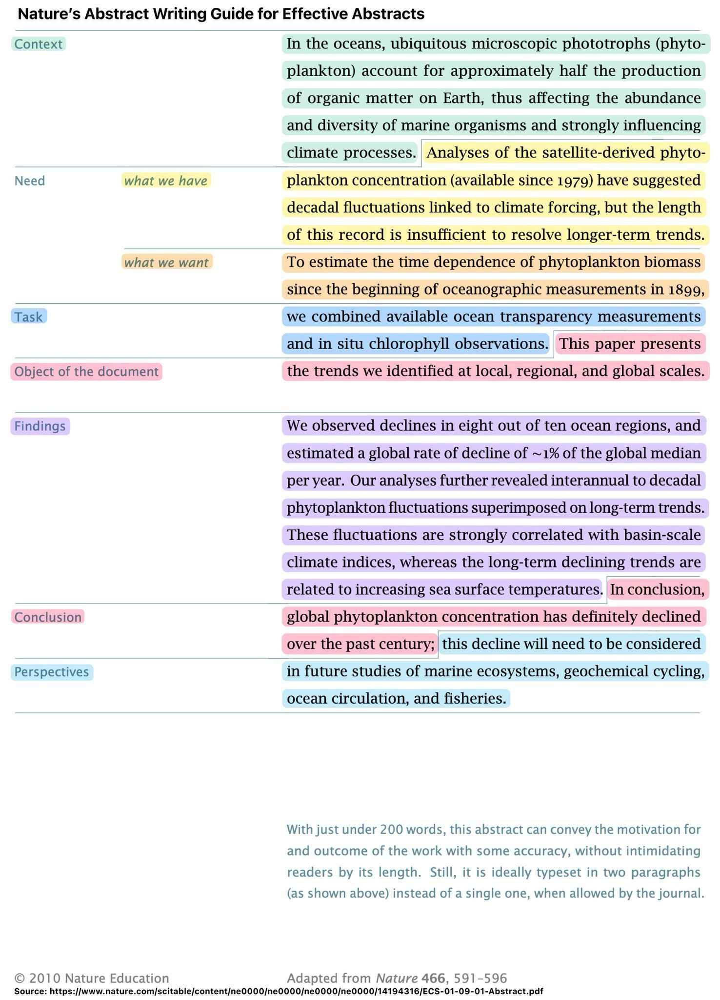

## Abstract V0.x

#### Why Write an Abstract Now?
*Why should you spend time to write an abstract now when you know that it will change drastically for the final output?*

Distilling your ideas to the most concise possible version is very useful in research.
During ideation, it allows you to

- Easily share your ideas
- Find holes in your own reasoning
- Confirm *why* you’re interested in the research

While developing experimentation and writing first drafts, it

- Informs your experiments — if they serve your abstract, you should probably reconsider them
- Guides your narrative — if a point doesn’t support your abstract, it probably shouldn’t be included
- Provides a concrete target

## It’s V0.x for a Reason

Keep in mind that this is an `Abstract V0.x` — you can and should change it as your research develops! However, it is worth always having *some* version of your abstract defined to help direct your research decisions.

# Writing an Abstract V0.x — one approach

Summarize your idea in as few words as possible such that another researcher in the field could read it and understand what you were trying to do. If you have written more than 1 paragraph (~5-10 sentences), see if you can trim it down some more.

One approach that may help with this is the <u>situation</u>*-***complication***-resolution* framework. A very generalized example is:

> LLMs widely deployed in context X.  **X has property Y that breaks Z and we don’t have enough data on it.** *We create a benchmark that shows that Y is only a problem for […] and can be addressed by method M.

#### Nature Infographic on Effective Abstracts
Although it is, at this point, ~15 years old, it is worth sharing an infographic made in the Journal Nature on the anatomy of an abstract.
